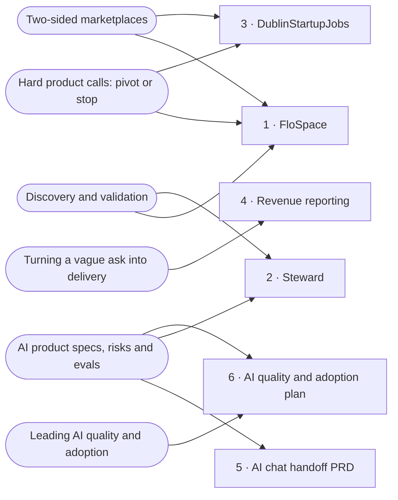

# Product casebook

  

Product work rarely shows up in a Git history. This repo is where I keep the parts that usually stay in Confluence or a Google Drive folder: the problem framing, the specs, the trade-offs and what happened afterwards.

I'm a Technical Product Owner and AI-native developer with 15+ years of shipping web products. Each case below is written up the same way so you can compare them quickly.

## Cases

| # | Case | Type | What it shows |
| --- | --- | --- | --- |
| 1 | [FloSpace: marketplace or LINE-native infrastructure?](cases/01-flospace.md) | Co-founded start-up, Bangkok | Discovery, a hard pivot decision, building on LINE |
| 2 | [Steward: AI-native SME succession for Southeast Asia](cases/02-steward.md) | Early-stage concept | Problem validation, positioning, where AI actually helps |
| 3 | [DublinStartupJobs.com: running a niche marketplace for 11 years](cases/03-dublinstartupjobs.md) | Founder, 2011 to 2022 | Two-sided marketplace basics, retention, knowing when to stop |
| 4 | [Revenue reporting a medical society could trust](cases/04-association-revenue-reporting.md) | Client engagement | Turning a vague reporting ask into a small, durable fix |
| 5 | [Example PRD: human handoff in an AI chat assistant](cases/05-example-prd-ai-chat-handoff.md) | Illustrative spec | How I write a PRD for an AI feature, risks and evals included |
| 6 | [Example plan: running AI quality and adoption after launch](cases/06-example-ai-quality-and-adoption-plan.md) | Illustrative plan | Owning an AI feature after launch: eval routines, decision rules, cost and team adoption |

## Which case to read

Short on time? Pick the skill you're hiring for and follow the line.

## Templates

The templates I actually use, cut down to what gets read:

- [PRD](templates/prd.md)
- [User story with acceptance criteria](templates/user-story.md)
- [Architecture or product decision record](templates/decision-record.md)

## How each case is structured

1. **Context**: the situation and who was involved
2. **Problem**: what was actually wrong, in one paragraph
3. **What I did**: discovery, decisions, delivery
4. **Decision record**: the call that mattered most, with the options I rejected
5. **Outcome and what I'd do differently**

Client names are left out where the work was under contract. Nothing here is confidential.

## About me

Barry Gildea, Bangkok (remote). Previously Technical Product Owner on AI chat and messaging products at American Express Global Business Travel. More on my [profile](https://github.com/bgildea).

## Licence

MIT. See [LICENSE](LICENSE).
